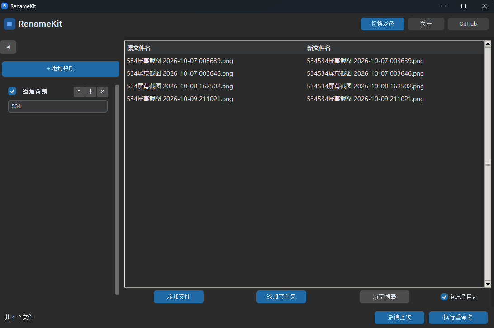

# RenameKit

**开源免费的 Windows 批量文件重命名工具**

拖拽即用 · 实时预览 · 一键撤销 · 无广告 · 无需注册 · 免安装



---

## 功能特性

- **拖拽导入**：把文件或整个文件夹拖进窗口即可，支持子目录递归、自动去重排序
- **规则链**：多条规则按顺序叠加生效，随时开关、上移下移、即改即看
  - 添加前缀 / 后缀
  - 查找替换（支持正则、大小写开关）
  - 序号编号（起始、步长、补零位数、位置、连接符）
  - 大小写转换 / 删除字符
- **实时预览**：原文件名 → 新文件名两列对照，规则一改立即重算
- **智能校验**：批内重名、磁盘冲突、非法字符、Windows 保留名、路径超长——冲突行黄/红标色，**有冲突禁止执行**
- **安全执行**：两阶段临时名中转，自动处理 A→B、B→C 循环改名；任何失败立即停止并**全量回滚**，要么全成、要么没动
- **一键撤销**：保留最近 10 次操作，随时还原
- **深色/浅色主题**，选择自动记忆
- 开源（MIT）、免费、无广告、不联网、不上传任何数据

---

## Windows 11 用户必读（Smart App Control）

> **双击 `RenameKit.exe` 提示"已被组织策略阻止"或无法启动？**
> 这是 Windows 11 的 **Smart App Control（智能应用控制）** 机制在拦截，
> **不代表这个程序是病毒**。RenameKit 未购买代码签名证书，未签名的
> 全新程序在开启 Smart App Control 的设备上会被默认拒绝。

按下面任一方法解决：

### 方法 A：关闭 Smart App Control（不推荐优先使用）

`Windows 安全中心` → `应用和浏览器控制` → `智能应用控制设置` → 选择 **关闭**

⚠️ **注意：关闭后不可逆**，除非重装系统，否则无法重新开启。
仅在你确认信任本程序、且愿意调整系统安全设置时使用。

### 方法 B：解除文件锁定（先试这个）

1. 右键点击 `RenameKit.exe` → `属性`
2. 在 `常规` 页底部勾选 **`解除锁定`**（Unblock）
3. 确定后重新双击运行

> 部分设备上此方法仍不足以绕过 Smart App Control，若无效请用方法 C。

### 方法 C：使用源码运行版（最稳，完全绕过该限制）

下载 **`RenameKit-source.zip`** → 解压到任意目录 → 双击 **`启动.bat`**。

启动.bat 会自动完成：检测 Python → 创建虚拟环境 → 安装依赖 → 启动程序。
（首次运行需要已安装 [Python 3.10+](https://www.python.org/downloads/) 并联网几分钟。）

---

## 下载

| 版本 | 说明 |
|---|---|
| **[RenameKit.exe](../../releases)** | 单文件免安装版（约 13MB），大多数用户选这个 |
| **[RenameKit-source.zip](../../releases)** | 源码运行版，exe 打不开时用它 |

> 📌 发布链接占位：上传 Release 后把上表替换为实际下载地址。

---

## 从源码构建

```bash
git clone https://github.com/NEJOGALO/RenameKit.git
cd RenameKit
python -m venv .venv
.venv\Scripts\pip install -r requirements.txt
.venv\Scripts\pyinstaller build/renamkit.spec    # 产出 dist/RenameKit.exe
```

源码打包为分发 zip：

```bash
python build/make_source_zip.py                   # 产出 dist/RenameKit-source.zip
```

---

## 系统要求

- Windows 10 / 11（x64）
- 源码运行版需自行安装 Python 3.10+

## 项目结构

```
src/main.py          入口
src/ui/              主窗口、规则面板、文件列表、底部操作栏
src/core/            规则引擎、执行引擎（两阶段中转+回滚）、校验器、撤销栈
src/utils/           配置、日志、文件操作
build/renamkit.spec  PyInstaller 打包配置（Windows x64 裁剪版）
启动.bat              源码运行版启动器
```

## 许可证

[MIT License](LICENSE) © 2026 NEJOGALO
